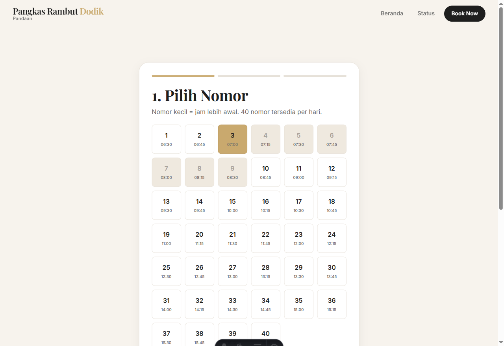
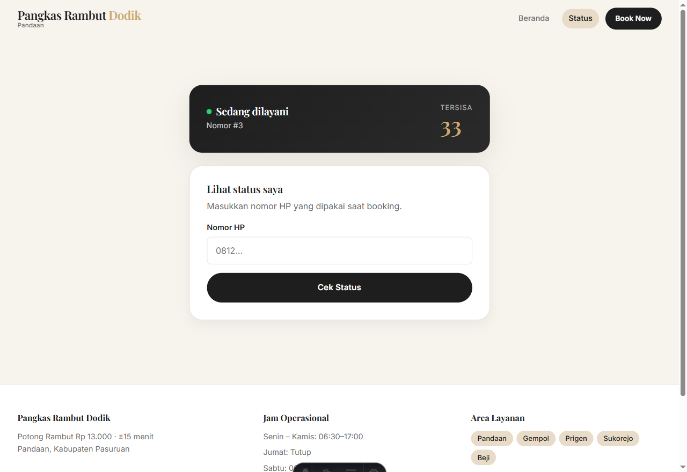
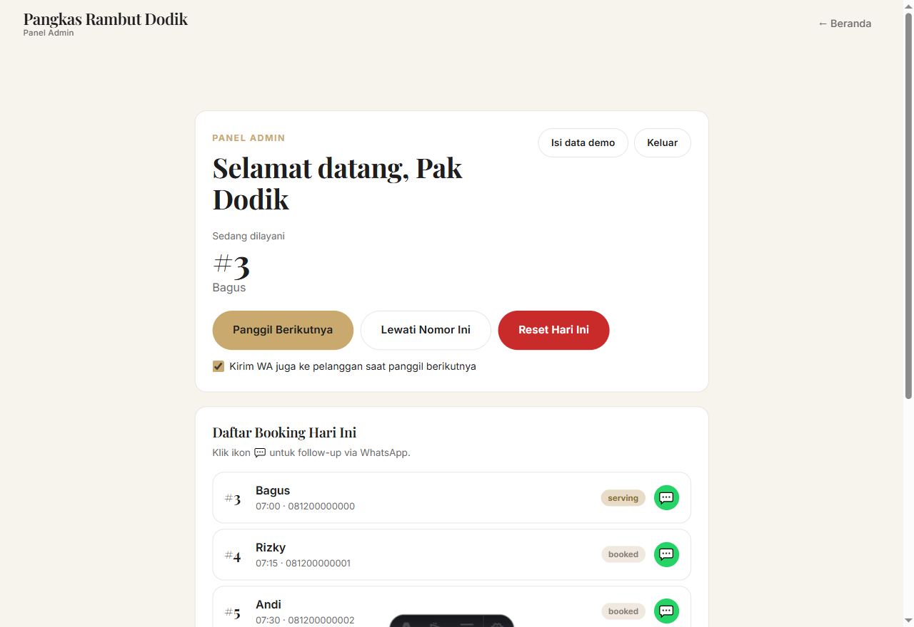
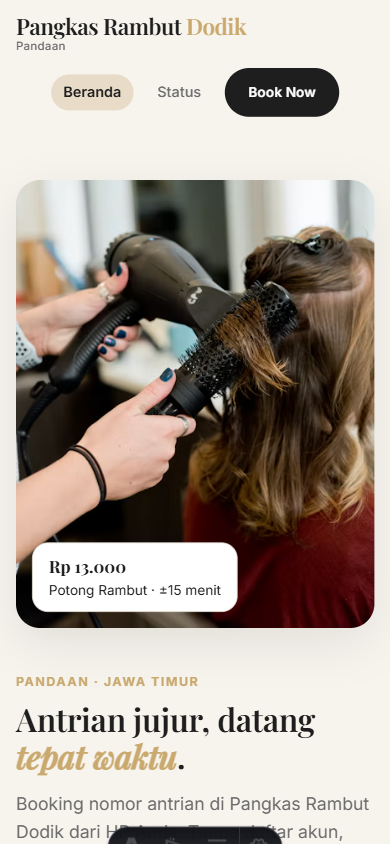

<h1 align="center">💈 Pangkas Rambut Dodik</h1>
<p align="center"><b>Sistem booking nomor antrian online</b> untuk barbershop satu kursi di Pandaan, Pasuruan.</p>

<p align="center">
  <a href="https://deploy.workers.cloudflare.com/?url=https://github.com/USERNAME/REPO"></a>
  <a href="https://github.com/USERNAME/REPO/actions/workflows/deploy.yml"></a>
  <br>
  
  
  
</p>

---

**Pangkas Rambut Dodik** adalah barbershop satu kursi di Pandaan. Pelanggan bisa **ambil nomor antrian (1–40) langsung dari HP tanpa login**, melihat estimasi giliran yang jujur, dan pemilik (Pak Dodik) mengelola antrian cukup dengan **3 tombol** + follow-up pelanggan via **WhatsApp** — semua berjalan di Cloudflare free tier (**Rp 0/bulan**).

## 📸 Pratinjau

| 🏠 Landing Page | 🎟️ Booking (pilih nomor) |
|:---:|:---:|
|  |  |

| 📡 Status Antrian | 🛡️ Panel Admin |
|:---:|:---:|
|  |  |

<p align="center"><b>📱 Tampilan Mobile</b></p>
<p align="center"></p>

## ✨ Fitur

| Area | Fitur |
|---|---|
| **Landing** (`/`) | 10 section SEO-friendly, JSON-LD `HairSalon` + `FAQPage`, responsif, hero animation + View Transitions |
| **Booking** (`/book`) | Wizard 3 langkah, 40 nomor × 15 menit (mulai 06:30 WIB), anti duplikat nomor & HP, proteksi **Turnstile** |
| **Status** (`/status`) | Antrian live (polling 20 dtk), cek via HP, batal booking |
| **Admin** (`/admin`) | Login HMAC (rate-limit 5x/menit), Panggil/Lewati/Reset + follow-up WhatsApp `wa.me` |
| **Backend** | Cloudflare Workers + D1 (SQLite), 11 endpoint API, auto-create tabel saat cold start |

## 🧱 Tech Stack

| Layer | Teknologi |
|---|---|
| Frontend | Astro 7 + React 19 (islands) |
| Styling | CSS custom design tokens (tanpa framework) |
| Runtime | Cloudflare Workers (`@astrojs/cloudflare`) |
| Database | Cloudflare D1 (SQLite) + migrasi otomatis |
| Auth | HMAC HttpOnly cookie |
| Anti-spam | Cloudflare Turnstile |
| CI/CD | GitHub Actions + `cloudflare/wrangler-action` |

## 🚀 Quick Start (lokal)

```sh
npm install
npm run dev        # http://localhost:4321
```

- Data demo disimpan di memori (fallback), password admin demo: `dodik`.
- Isi data asli di `src/data/site.json` (lihat **Data & Secret**).

```sh
npm run build      # build produksi ke ./dist
npm run check:data # validasi kelengkapan data klien
```

## ⚡ One-Click Deploy ke Cloudflare

### Metode 1 — GitHub Actions (disarankan)
1. Set 2 secret di repo (Settings → Secrets → Actions): `CLOUDFLARE_API_TOKEN`, `CLOUDFLARE_ACCOUNT_ID`.
2. Isi `database_id` D1 di `wrangler.toml` (`npm run d1:create`) + data klien di `src/data/site.json`.
3. **Satu klik**: tab Actions → workflow **"Deploy Pangkas Dodik"** → **Run workflow** (atau cukup `git push origin main`).

### Metode 2 — Tombol "Deploy with Workers"
Klik **"Deploy to Cloudflare"** di atas (ganti `USERNAME/REPO`) → connect repo GitHub → Cloudflare baca `wrangler.toml` otomatis → deploy. Setelah itu buat D1 + set secret sekali.

Selengkapnya: [`DEPLOY-GITHUB.md`](DEPLOY-GITHUB.md) dan [`DEPLOY.md`](DEPLOY.md).

## 📁 Struktur Proyek

```text
├── src/
│   ├── pages/            # route (.astro) + API endpoints (/api/*)
│   │   ├── index.astro   # landing
│   │   ├── book.astro    # booking
│   │   ├── status.astro  # status antrian
│   │   ├── admin.astro   # panel admin
│   │   └── api/          # queue, book, cancel, lookup, admin/*
│   ├── components/
│   │   ├── Header.astro / Footer.astro
│   │   └── react/        # LiveQueue, BookingWizard, StatusPanel, AdminPanel, TurnstileWidget
│   ├── layouts/BaseLayout.astro
│   ├── lib/
│   │   ├── util.ts       # helper & types (shared)
│   │   ├── api.ts        # client fetch ke /api/*
│   │   └── server/       # db.ts (D1+memory), auth.ts (HMAC), turnstile.ts, ratelimit.ts, http.ts
│   ├── data/             # site.json, faq.json (single source of truth)
│   └── styles/global.css
├── migrations/0001_init.sql   # skema D1
├── .github/workflows/deploy.yml # CI/CD
├── wrangler.toml
└── docs/                 # PRD, panduan deploy, studi HTML, screenshot
```

## 🔐 Data & Secret

- **Data publik** (ganti sesuai klien): `src/data/site.json` — harga, jam, alamat, nomor WA, foto, tautan Maps. Cek `npm run check:data`.
- **Secret admin** (jangan commit, set via `wrangler secret put` / dashboard): `ADMIN_PASSWORD`, `ADMIN_SECRET`.
- **Turnstile** (opsional, anti-spam): `PUBLIC_TURNSTILE_SITE_KEY` (build) + `TURNSTILE_SECRET_KEY` (secret). Tanpa ini captcha nonaktif.
- `.dev.vars` (lokal) dan `.env*` sudah di-`.gitignore`.

## 📚 Dokumentasi

- [`docs/PRD-Pangkas-Rambut-Dodik.md`](docs/PRD-Pangkas-Rambut-Dodik.md) — Product Requirements Document lengkap.
- [`DEPLOY-GITHUB.md`](DEPLOY-GITHUB.md) — panduan deploy otomatis via GitHub.
- [`DEPLOY.md`](DEPLOY.md) — panduan deploy manual (CLI).
- [`docs/STUDI-HTML-Pangkas-Dodik.md`](docs/STUDI-HTML-Pangkas-Dodik.md) — studi HTML mentah.

## ✅ Alur Booking (ringkas)

1. Pelanggan pilih nomor (1–40) → isi nama & HP → verifikasi Turnstile → konfirmasi.
2. Sistem simpan booking di D1 (jam slot = `06:30 + (nomor-1) × 15 menit`).
3. Pelanggan pantau status di `/status` (polling 20 dtk).
4. Pak Dodik di `/admin`: **Panggil Berikutnya / Lewati / Reset**, dan kirim WhatsApp follow-up ke pelanggan.

## 🧾 Catatan

- Placeholder yang **wajib diisi sebelum produksi**: nomor WhatsApp, alamat lengkap, foto asli Dodik, dan `database_id` D1.